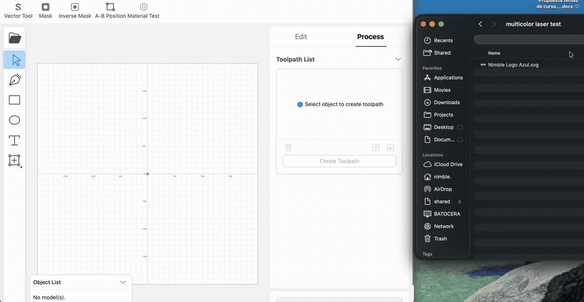

Luban Next
==========

[Luban Next](https://github.com/JPaulMora/Luban-Next) is a fork of [Snapmaker Luban](https://github.com/Snapmaker/Luban). The current version is 4.17.0.

## New features vs Luban

### Laser SVG colors

Import a multi-color SVG and choose **Process each color** or **Import as one object**. Process each color splits the original file into one object and toolpath per fill or stroke.



### Faster startup

4.16.0 reaches the home screen much faster than 4.15.0.

On one Mac, timed on 24 October 2026, the clock ran from process start until the home screen showed Get Started:

| Version | Where it ran | Time |
| --- | --- | --- |
| 4.15.0 | `/Applications/Snapmaker Luban.app` | 24.1 s |
| 4.16.0 | Luban Next macOS arm64 build | 4.1 s |

That is about six times faster to the home screen.

### Toolchain

React 18, Webpack 5, and native-module rebuilds that run on Python 3.12+.

---

Snapmaker Luban
===============

[](https://github.com/Snapmaker/Luban/actions)

Snapmaker Luban is an easy-to-use 3-in-1 software tailor-made for Snapmaker machines.
You can customize the printer settings and control the machine in Luban anytime with ease.
The software also provides G-code generation support for 3D models, laser engraving / cutting, and CNC milling.

Our goal is to provide a multi-functional 3D software, while making it as accessible and customizable as possible for new users / beginners.

The software is inspired by [cncjs](https://github.com/cncjs/cncjs) by cheton.
We use [LunarSlicer](https://github.com/Snapmaker/LunarSlicer) for 3D slicing.


## How to install and run

### Run released applications

You can download latest releases of software under the ["**Releases**"](https://github.com/JPaulMora/Luban-Next/releases) section.
It's recommended to use a stable release version unless you want to do some modifications on the source code.

For Linux distros (Debian for example), you may need to run following commands to install dependencies for Luban:

```Bashhist
> sudo dpkg --install snapmaker-luban-{version}-linux-amd64.deb
> sudo apt install --fix-broken
```

### Run from source code

Checkout [Development](./docs/Development.md) to how to run and develop from source code.

## Feedback & Contribution

- To submit a bug or feature request, [file an issue](https://github.com/JPaulMora/Luban-Next/issues/new) in github issues.
- To contribute some code, make sure you have read and followed our guidelines for [contributing](https://github.com/Snapmaker/Luban/blob/master/CONTRIBUTING.md).

## Translations

We use crowdin for collaborative translations. We would greatly appreciate your assistance in improving our translations.

| Language | Crowdin Link |
| ---------| -------------|
| Ukrainian (Українська) | [Ukrainian translations](https://crowdin.com/project/luban/uk) |
| German (Deutsch) | [German translations](https://crowdin.com/project/luban/de) |
| Italian (Italiano) | [Italian translations](https://crowdin.com/project/luban/it) |
| Chinese Simplified (简体中文) | [Chinese translations](https://crowdin.com/project/luban/zh-CN) |


## License
Snapmaker Luban is released under terms of the AGPLv3 License.

Terms of the license can be found in the LICENSE file or at http://www.gnu.org/licenses/agpl-3.0.html.
